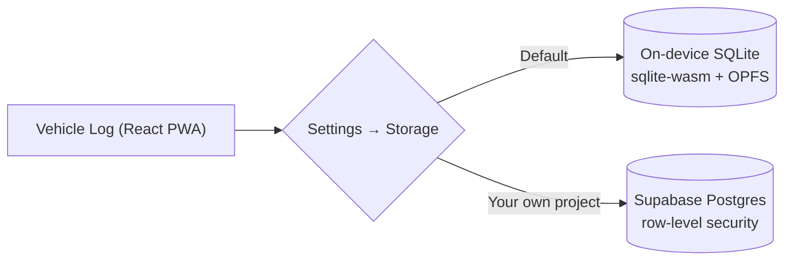

<div align="center">


# Vehicle Log

**Fuel, mileage, services, expenses and maintenance reminders for all your vehicles, in one installable app.**

Works offline with on-device SQLite, or syncs through your own free Supabase project.


[Features](#-features) · [Quick start](#-quick-start) · [Storage](#-choose-where-your-data-lives) · [Deploy](#-deploy-for-free) · [Backups](#-backups) · [Project layout](#-project-layout)

</div>

---

## ✨ Features

| | |
|---|---|
| 🚗 **Multiple vehicles** | Switch from the sidebar or top bar. Archive vehicles you've sold. |
| ⛽ **Fuel log** | km/L is calculated full-tank to full-tank, and partial fills are counted correctly. Optionally record the litres left in the tank for tank-level efficiency. |
| 🔧 **Service & expenses** | Services, repairs, tyres, insurance, tax/registration, cleaning and more, each with a category, vendor and notes. |
| 🔔 **Reminders** | Due by distance, by time, or whichever comes first (for example oil every 10,000 km or 12 months). Logging a service can reset the reminders it covers. An overdue badge appears on the nav. |
| 📊 **Reports** | Monthly spend (chart or table), spend by category, and the fuel-efficiency trend. |
| 💾 **Backups** | Export and restore as `.sqlite`, JSON or CSV from the app, plus a scheduled backup script for Windows. |
| 📱 **Installable PWA** | Add it to your home screen and it opens full screen like a native app. The layout adapts from phone to desktop. |
| 🔒 **Private by default** | Nothing leaves your device unless you connect your own Supabase project. |

## 🚀 Quick start

```bash
npm install
npm run dev        # http://localhost:5173
```

| Command | What it does |
|---|---|
| `npm run dev` | Start the Vite dev server |
| `npm run build` | Type-check and build to `dist/` |
| `npm run preview` | Serve the production build locally |
| `npm test` | Run the unit tests (Vitest) |
| `npm run backup` | Write a JSON backup from Supabase (see [Backups](#-backups)) |

Optional: copy `.env.example` to `.env.local` to set `VITE_CURRENCY`, the display currency (ISO code, default `INR`).

## 🗄️ Choose where your data lives



| | **On-device (default)** | **Supabase** |
|---|---|---|
| Account needed | No | Yes (your own free project) |
| Sync between devices | No | Yes |
| Where data is stored | Browser origin-private file system | Your Supabase database |
| Good to know | Per browser profile. Clearing site data deletes it. Only one tab can open the database at a time. | Free projects pause after about a week of inactivity. |

Supabase credentials are **never baked into the build**. Each person enters their own project URL and anon key in
**Settings → Storage**, so no rebuild is needed. When you switch storage, the app can copy your data across and
handles conflicts.

**Settings → Backup & restore** downloads your data as `.sqlite`, JSON or CSV, and restores from `.sqlite` or JSON
into either storage.

<details>
<summary><b>Set up Supabase (optional, free tier)</b></summary>

1. Sign up at <https://supabase.com> and create a new project in a region close to you.
2. Open **SQL Editor → New query**, paste [supabase/schema.sql](supabase/schema.sql) and click **Run**.
3. In **Project Settings → API**, copy the **Project URL** and the **anon public** key.
4. Run `npm run dev`, open **Settings → Storage**, choose Supabase and enter the URL and anon key. Create your
   account and sign in.

The anon key is safe to ship in a website. Row-level security in the schema means each signed-in user can only read
and write their own rows.

**Email confirmation:** Supabase sends a confirmation email on sign-up by default. If you're the only user, turn it
off under **Authentication → Sign In / Providers → Email → Confirm email**. If you keep it on, set
**Authentication → URL Configuration → Site URL** to your deployed URL so the email link points there.

**Stop strangers signing up:** once your account exists, disable **Authentication → Sign In / Providers →
Allow new users to sign up**.

</details>

## 🌐 Deploy for free

The app is a static site, so any static host works. With Vercel:

1. Push this folder to a GitHub repository (private is fine).
2. On <https://vercel.com>, choose **Add New → Project** and import the repo. Framework preset: **Vite**.
3. Optionally add the `VITE_CURRENCY` environment variable.
4. Deploy. Every push to the main branch redeploys.

For Netlify or Cloudflare Pages, use build command `npm run build` and output directory `dist`.

**On your phone:** open the site and choose *Add to Home screen* (Android Chrome, or the iOS Safari Share menu).
Data refreshes whenever you switch back to the app.

## 💾 Backups

### Manual

In **Settings**: *Download backup (JSON)* saves everything. *Restore from backup…* loads a file back in (it
overwrites matching entries and never deletes anything). *Export spreadsheet (CSV)* gives you a file for Excel.

### Automatic daily backup (Windows, Supabase mode)

1. Copy `.env.backup.example` to `.env.backup` and fill in the Supabase URL, anon key, and your app email and
   password. The file is git-ignored and stays on your PC.
2. Test it: `npm run backup` writes `backups/vehicle-log-YYYY-MM-DD.json`.
3. Schedule it (daily at 21:00, or at next start-up if the PC was off):

   ```powershell
   powershell -ExecutionPolicy Bypass -File scripts\schedule-backup.ps1
   # different time:
   powershell -ExecutionPolicy Bypass -File scripts\schedule-backup.ps1 -Time "08:30"
   ```

| Setting | Default | Purpose |
|---|---|---|
| `BACKUP_DIR` | `./backups` | Where backups are written. Point it inside OneDrive or Google Drive for an off-PC copy. |
| `BACKUP_KEEP` | `60` | Older backups beyond this count are deleted. |

Output is logged to `backups/backup.log`. As a side benefit, the daily run counts as activity and keeps a free
Supabase project from pausing.

**Restoring after a disaster:** create a new Supabase project, run `supabase/schema.sql`, update the URL and key in
**Settings → Storage**, sign up again, then use **Settings → Restore from backup…** with your latest JSON file.

## 🧱 Tech stack

- **UI:** React 18 + TypeScript, bundled with Vite
- **On-device storage:** `@sqlite.org/sqlite-wasm` in a Web Worker, persisted to the origin-private file system
- **Cloud storage (optional):** Supabase (Postgres, auth and row-level security)
- **Offline and install:** service worker and web app manifest
- **Tests:** Vitest

## 📁 Project layout

```text
.
├── src/
│   ├── App.tsx              # Shell, navigation, vehicle picker
│   ├── components/          # Overview, Fuel, Service, Reminders, Reports, Settings views
│   └── lib/
│       ├── calc.ts          # Efficiency, reminder status and cost maths (unit-tested)
│       ├── db.ts            # Data access: on-device SQLite or Supabase
│       ├── merge.ts         # Conflict handling when copying data between storages
│       ├── sqlite/          # sqlite-wasm client, worker and store
│       └── types.ts         # Vehicle, FuelLog, ServiceLog, Reminder, backup format
├── supabase/schema.sql      # Tables and row-level security
├── scripts/
│   ├── backup.mjs           # Local backup script
│   └── schedule-backup.ps1  # Registers the daily Windows scheduled task
└── public/                  # Icon, web manifest, service worker
```
